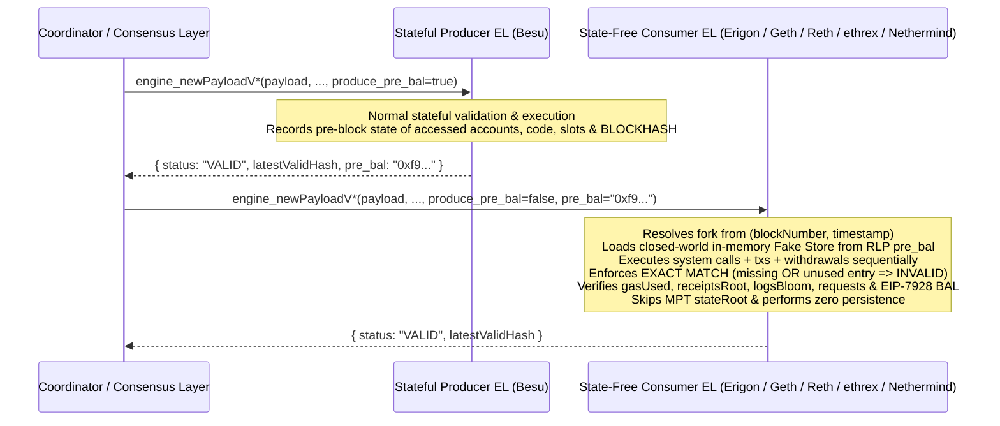

# `reexecute` — Pre-Execution Block Access List (`Pre-BAL`) Experiment

`reexecute` is a multi-client Ethereum Execution Layer (EL) experiment introducing **Pre-Execution Block Access Lists (`Pre-BAL`)** on `engine_newPayloadV*` for fast, state-free cross-client block re-execution.

- **Full Protocol & Wire Specification**: [SPEC.md](./SPEC.md)
- **Engine API & OpenRPC Specification**: [execution-apis/src/engine/pre-bal.md](./execution-apis/src/engine/pre-bal.md) · [execution-apis/src/schemas/pre-bal.yaml](./execution-apis/src/schemas/pre-bal.yaml)

---

## Motivation

Cross-client block verification (e.g., shadow verification clusters, multi-client diversity guards, or enclave re-executors) traditionally faces two expensive options:

1. **Full Stateful Nodes**: Every verifier maintains hundreds of GiB of Ethereum world state on disk and computes Merkle Patricia Trie (MPT) `stateRoot` updates.
2. **Cryptographic Stateless Witnesses (EIP-8025)**: Every payload ships MPT sibling proofs and hashes trie nodes in CPU to verify `stateRoot` trustlessly.

When a **stateful Producer EL** is paired with one or more **state-free Consumer ELs** that trust the Producer's pre-state values (and only want independent EVM + consensus verification of the block transition), MPT proofs and `stateRoot` hashing are unnecessary overhead.

`reexecute` adds two optional trailing parameters—`produce_pre_bal` and `pre_bal`—to `engine_newPayload`:



---

## Pre-BAL vs. EIP-7928 BAL vs. EIP-8025 ExecutionWitness

Ethereum's adopted **EIP-7928 Block Access List** records *post-transaction* mutations and *key-only* storage reads to accelerate parallel disk prefetching on stateful nodes—it omits pre-execution balances, nonces, existing contract bytecodes, read slot values, pre-write slot values (required for EIP-2200/2929/3529 `SSTORE` gas/refund rules), and parent header / `BLOCKHASH` context.

| Property | EIP-7928 BAL (Adopted) | EIP-8025 ExecutionWitness | **`reexecute` Pre-BAL** |
| :--- | :--- | :--- | :--- |
| **Target Node** | Stateful EL (disk prefetch & parallel tx execution) | Trustless stateless verifier | **Trusting state-free Consumer EL** |
| **State Values Carried** | Post-tx writes + read-only slot keys | MPT trie nodes + bytecodes + headers | **Flat pre-block `(exists, nonce, balance, code, storage)` + `parentHeader` + `BLOCKHASH`es** |
| **MPT Proof / Hashing Overhead** | Full local MPT | Full witness MPT verification | **None (`stateRoot` skipped on Consumer)** |
| **Access-Set Definition** | Consensus EIP-7928 rules | Accessed trie leaves | **Anchored to EIP-7928 access set + exact `BLOCKHASH` queries** |
| **Consumer Matching Policy** | Exact consensus BAL hash | Valid witness proof | **Closed-world Fake Store + Exact Match (missing or extra entry => `INVALID`)** |
| **Consumer Persistence** | Full block & state import | Stateless | **Zero persistence (stateless verification only)** |

---

## Engine API & Wire Format Overview

### `engine_newPayloadV1`–`V6` Extension

Two optional trailing parameters are appended to `engine_newPayloadV1` through `engine_newPayloadV6`:

- `produce_pre_bal`: `BOOLEAN | null` *(default `false`)* — Instructs a Producer EL to return the hex-encoded RLP `PreBlockAccessList` in `PayloadStatus.pre_bal` alongside normal `newPayload` validation.
- `pre_bal`: `DATA | null` *(default `null`)* — Supplies the hex-encoded RLP `PreBlockAccessList` to a Consumer EL for stateless Fake-Store verification.
- Supplying both `produce_pre_bal = true` and `pre_bal != null` (or malformed hex/RLP or a `parent_header` whose `Keccak256` does not equal `executionPayload.parentHash`) returns JSON-RPC `-32602` (`Invalid params`).

### Canonical RLP Schema

```text
PreBlockAccessList = [
    parent_header: bytes,              // Raw RLP parent BlockHeader; Keccak256(parent_header) == payload.parentHash
    accounts: List[PreAccountState],   // Strictly sorted ascending by 20-byte address
    block_hashes: List[PreBlockHash]   // Strictly sorted ascending by uint64 block_number
]

PreAccountState = [
    address: bytes20,
    exists: bool,                      // 0x80 (false) iff EIP-161 empty/absent, 0x01 (true) otherwise
    nonce: uint64,
    balance: uint256,
    code: bytes,
    storage: List[PreStorageSlot]      // Strictly sorted ascending by uint256 key (reads ∪ writes)
]

PreStorageSlot = [key: uint256, value: uint256]
PreBlockHash   = [block_number: uint64, block_hash: bytes32]
```

### Consumer Verification Guarantees

1. **Fork Resolution from Payload**: Active hardfork rules (`Paris` through `Amsterdam` / `Bogota`) are resolved directly from `(executionPayload.blockNumber, executionPayload.timestamp)` against the Consumer's chain configuration.
2. **Closed-World Fake Store**: Only accounts, bytecodes, storage slots, and `BLOCKHASH` entries declared in `pre_bal` exist in the Consumer's in-memory store. Any undeclared read immediately aborts execution and returns `{ status: "INVALID", latestValidHash: parentHash }`.
3. **Exact-Match Minimality**: Every account, storage slot (`storageReads ∪ storageChanges` under EIP-7928 rules), and `BLOCKHASH` entry in `pre_bal` must be canonically accessed during execution; any unused entry also fails validation with `{ status: "INVALID", latestValidHash: parentHash }`.
4. **Consensus Commitment Checks**: Consumer verifies parent-relative header rules (`gasLimit`, EIP-1559 `baseFeePerGas`, EIP-4844 `excessBlobGas`), `blockHash`, `gasUsed`, `blobGasUsed`, `receiptsRoot`, `logsBloom`, `executionRequests`, and (on Amsterdam+) EIP-7928 `blockAccessList`, while skipping MPT `stateRoot` computation and writing nothing to disk.

---

## Repository Layout & Client Support

Each specification and client lives in a Git submodule with its `reexecute` Producer or Consumer implementation:

| Submodule | Language | Role | Engine API Versions | Key Implementation Paths |
| :--- | :--- | :--- | :--- | :--- |
| [`execution-apis`](./execution-apis) | Markdown / OpenRPC | **Specification** | `V1`–`V6` | [`src/engine/pre-bal.md`](./execution-apis/src/engine/pre-bal.md), [`src/schemas/pre-bal.yaml`](./execution-apis/src/schemas/pre-bal.yaml), [`src/engine/openrpc/methods/payload.yaml`](./execution-apis/src/engine/openrpc/methods/payload.yaml) |
| [`besu`](./besu) | Java | **Pre-BAL Producer** | `V1`–`V5` | [`PreBlockAccessList.java`](./besu/ethereum/core/src/main/java/org/hyperledger/besu/ethereum/mainnet/block/access/list/PreBlockAccessList.java), [`PreBlockAccessListBuilder.java`](./besu/ethereum/core/src/main/java/org/hyperledger/besu/ethereum/mainnet/block/access/list/PreBlockAccessListBuilder.java), [`EngineNewPayloadV1.java`](./besu/ethereum/api/src/main/java/org/hyperledger/besu/ethereum/api/jsonrpc/internal/methods/engine/EngineNewPayloadV1.java) |
| [`erigon`](./erigon) | Go | **Pre-BAL Consumer** | `V1`–`V5` | [`execution/types/prebal/prebal.go`](./erigon/execution/types/prebal/prebal.go), [`execution/prebal/executor.go`](./erigon/execution/prebal/executor.go), [`execution/engineapi/engine_server.go`](./erigon/execution/engineapi/engine_server.go) |
| [`ethrex`](./ethrex) | Rust | **Pre-BAL Consumer** | `V1`–`V5` | [`pre_block_access_list.rs`](./ethrex/crates/common/types/pre_block_access_list.rs), [`pre_bal_db.rs`](./ethrex/crates/vm/pre_bal_db.rs), [`blockchain.rs`](./ethrex/crates/blockchain/blockchain.rs), [`payload.rs`](./ethrex/crates/networking/rpc/engine/payload.rs) |
| [`go-ethereum`](./go-ethereum) | Go | **Pre-BAL Consumer** | `V1`–`V5` | [`core/types/prebal/prebal.go`](./go-ethereum/core/types/prebal/prebal.go), [`core/prebal.go`](./go-ethereum/core/prebal.go), [`eth/catalyst/api.go`](./go-ethereum/eth/catalyst/api.go) |
| [`nethermind`](./nethermind) | C# / .NET | **Pre-BAL Consumer** | `V1`–`V6` | [`PreBlockAccessList.cs`](./nethermind/src/Nethermind/Nethermind.Merge.Plugin/PreBal/PreBlockAccessList.cs), [`PreBalWorldState.cs`](./nethermind/src/Nethermind/Nethermind.Merge.Plugin/PreBal/PreBalWorldState.cs), [`PreBalExecutionHandler.cs`](./nethermind/src/Nethermind/Nethermind.Merge.Plugin/PreBal/PreBalExecutionHandler.cs) |
| [`reth`](./reth) | Rust | **Pre-BAL Consumer** | `V1`–`V6` | [`crates/ethereum/node/src/pre_bal.rs`](./reth/crates/ethereum/node/src/pre_bal.rs), [`crates/ethereum/node/src/engine.rs`](./reth/crates/ethereum/node/src/engine.rs), [`crates/rpc/rpc-engine-api/src/engine_api.rs`](./reth/crates/rpc/rpc-engine-api/src/engine_api.rs) |
| [`vouch`](./vouch) | Go | **Pre-BAL Engine API Proxy** | `V1`–`V6` | [`executionproxy.go`](./vouch/executionproxy.go), [`services/executionproxy/standard/service.go`](./vouch/services/executionproxy/standard/service.go), [`docs/executionproxy.md`](./vouch/docs/executionproxy.md) |

---

## Getting Started

### Clone

```sh
git clone https://github.com/catwith1hat/reexecute.git
cd reexecute
git submodule update --init --jobs 6
```

> **Note**: When pushing forked submodules to GitHub, update `.gitmodules` URLs to point to the forked client repositories if cloning fresh on another machine, as upstream repositories do not carry the experimental `reexecute` commits.

### Run Verification Suites

#### 1. Engine API OpenRPC Spec (`execution-apis`)
```sh
cd execution-apis
make build && make test && make lint
```

#### 2. Besu — Pre-BAL Producer (`besu`)
Runs RLP unit tests, `engine_newPayload` Producer RPC tests, and full Prague EVM block execution (optionally exporting a cross-client JSON fixture via `PREBAL_FIXTURE_OUT`):
```sh
cd besu
PREBAL_FIXTURE_OUT=/tmp/besu-pre-bal-fixture.json ./gradlew \
  :ethereum:core:test --tests "*PreBlockAccessList*" \
  :ethereum:api:test --tests "*EngineNewPayloadPreBalTest*"
```

#### 3. Geth — Pre-BAL Consumer (`go-ethereum`)
Runs RLP tests, closed-world Fake Store & exact-match tests across forks, Engine API RPC tests, and cross-client verification against Besu's Prague `pre_bal` fixture:
```sh
cd go-ethereum
go test ./core/types/prebal/... ./core -run "PreBAL"
go test -v ./eth/catalyst -run "PreBAL"
```

#### 4. ethrex — Pre-BAL Consumer (`ethrex`)
Runs RLP invariant tests, LEVM Fake Store & exact-match tests, Auth-RPC HTTP + JWT tests, and Besu cross-client verification:
```sh
cd ethrex
cargo test -p ethrex-common pre_block_access_list
cargo test -p ethrex-rpc --lib pre_bal_tests
```

#### 5. Nethermind — Pre-BAL Consumer (`nethermind`)
Runs RLP tests, `engine_newPayloadV1`–`V6` stateless Consumer tests, and Besu cross-client verification:
```sh
cd nethermind/src/Nethermind
dotnet test Nethermind.Merge.Plugin.Test/Nethermind.Merge.Plugin.Test.csproj \
  -c Release --filter "FullyQualifiedName~PreBal"
```

#### 6. Reth — Pre-BAL Consumer (`reth`)
Runs `PreBlockAccessList` RLP & `PreBalDatabase` Fake Store tests, `engine_newPayload` RPC tests, and Besu cross-client verification:
```sh
cd reth
cargo test --lib -p reth-node-ethereum pre_bal
cargo test --lib -p reth-rpc-engine-api pre_bal
```

#### 7. Erigon — Pre-BAL Consumer (`erigon`)
Runs `PreBlockAccessList` RLP tests, closed-world Fake Store & exact-match execution tests across `Shanghai`–`Amsterdam`, `engine_newPayloadV1`–`V5` RPC tests, and Besu cross-client verification:
```sh
cd erigon
GOEXPERIMENT=jsonv2 go test ./execution/types/prebal ./execution/prebal
GOEXPERIMENT=jsonv2 go test -v ./execution/engineapi -run "PreBAL"
```

#### 8. Vouch — Pre-BAL Engine API Verification Proxy (`vouch`)
Runs the Engine API verification proxy tests (coordinating `produce_pre_bal = true` on the Producer EL and fanning out `pre_bal` verification across Consumer ELs):
```sh
cd vouch
go test ./... -run "ExecutionProxy|PreBAL"
```
