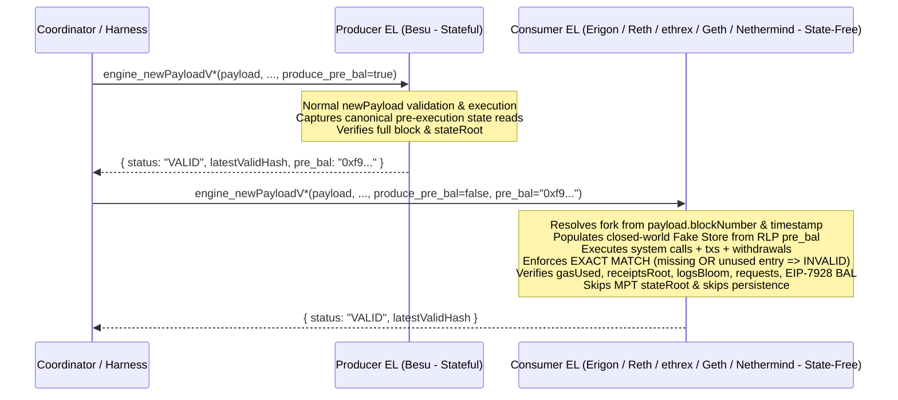

# Pre-BAL Execution & Stateless Fake-Store Verification Specification

## 1. Motivation & Overview

Validating an Ethereum `ExecutionPayload` traditionally requires either:
1. **Full Stateful Execution**: Holding the entire Ethereum world state (~hundreds of GiB on disk) to read pre-state accounts, contract bytecodes, and storage slots, and updating the Merkle Patricia Trie (MPT) to verify `stateRoot`.
2. **Cryptographic Stateless Execution (EIP-8025 / ExecutionWitness)**: Shipping full Merkle Patricia Trie proofs (sibling branch/extension nodes, headers, codes) alongside the block so a stateless verifier can cryptographically verify pre-state against `parent.stateRoot` and compute the post-state `stateRoot`. While trustless, MPT witnesses incur substantial bandwidth and heavy Keccak256 trie-hashing CPU overhead.

In architectures where a **stateful Producer EL** is paired with one or more **state-free Consumer ELs** (e.g., cross-client shadow verification to catch EVM/consensus implementation bugs, TEE/enclave verification, or pure EVM re-execution clusters), the Consumer EL does **not** need MPT proofs if it trusts the Producer EL's pre-execution key-value states.

This specification defines the **Pre-Execution Block Access List (`Pre-BAL`)** protocol over `engine_newPayloadV*`:
1. **Producer Mode (`produce_pre_bal = true`)**: A stateful EL (**Besu**) executes and validates an incoming `ExecutionPayload` as usual (`newPayload` imports/validates the block without updating canonical head until `engine_forkchoiceUpdated`) and returns a hex-encoded RLP `pre_bal` containing the exact **pre-execution** states of every accessed account, contract bytecode, storage slot, RLP-encoded parent header, and `BLOCKHASH` lookup.
2. **Consumer Mode (`pre_bal` supplied)**: A state-free EL (**Erigon**, **Reth**, **ethrex**, **Geth**, **Nethermind**) receives the `ExecutionPayload` and hex-encoded RLP `pre_bal`, resolves the active fork rules directly from the payload's `blockNumber` and `timestamp` against its chain config, loads `pre_bal` into an isolated closed-world in-memory **Fake Store**, enforces **exact-match** access (both undeclared reads and unused `pre_bal` entries fail validation), skips MPT `stateRoot` computation, and performs pure stateless verification with zero persistence.



---

## 2. Background: Ethereum's Adopted BAL (EIP-7928) vs. Pre-BAL

Ethereum standardized **Block-Level Access Lists (BALs)** in **EIP-7928** (activated in Amsterdam via `ExecutionPayloadV4` and `engine_newPayloadV5`). EIP-7928 records **post-transaction values** for writes and **keys only (no values)** for reads, because EIP-7928 targets *stateful* nodes that still read pre-states from disk.

| Dimension | Ethereum Adopted BAL (EIP-7928) | Our Experimental Pre-BAL |
| :--- | :--- | :--- |
| **Primary Goal** | Parallel disk prefetch, parallel tx scheduling, state-diff sync on **stateful** nodes | **State-free** EVM re-execution & verification on a trusting Consumer EL via a Fake Store |
| **Where Carried** | Consensus block body (`ExecutionPayloadV4.blockAccessList`) & header hash | Out-of-band Engine API parameter (`pre_bal`) and response field (`PayloadStatus.pre_bal`), RLP-encoded |
| **Account Balance / Nonce** | **Post-tx** `BalanceChange` / `NonceChange`; omits read-only balances/nonces | **Pre-block** `(exists, nonce, balance)` before index `0` for *every* accessed account (read or write) |
| **Contract Bytecode** | Only *newly deployed / delegated* `CodeChange`; omits existing executed contract code | **Pre-block** `code` for every accessed account (`0x` if EOA / empty) |
| **Storage Reads (`SLOAD`)** | `storageReads: [slotKey]` — **keys only, no values** | `storage: [[key, value]]` — includes **pre-block `uint256` value** (`0` if uninitialized) |
| **Storage Writes (`SSTORE`)** | `storageChanges: [[slotKey, [[txIdx, postValue]]]]` — **post-tx values only** | `storage: [[key, value]]` — includes **pre-block `uint256` value** (required for EIP-2200/2929/3529 `SSTORE` original-value gas & refund accounting) |
| **Ancestor `BLOCKHASH`** | Not included (assumes local header chain) | `blockHashes: [[blockNumber, blockHash]]` for every in-range `BLOCKHASH` opcode call |
| **Parent Header Context** | Not included (assumes local parent block) | `parentHeader` (RLP-encoded parent header, verified via `Keccak256(parentHeader) == payload.parentHash`) |
| **Access-Set Semantics** | Consensus-exact set of accessed addresses & storage keys | **Identical EIP-7928 canonical access-set rules**, guaranteeing exact-match agreement across all 6 clients |
| **Post-Execution `stateRoot`** | Computed via local MPT + `ApplyBlockAccessList` | **Skipped** on Consumer EL (no sibling MPT nodes; `stateRoot` is trusted, all other commitments verified) |

---

## 3. Engine API Specification

### 3.1 Fork Determination via Payload Fields

Every `ExecutionPayload` (`ExecutionPayloadV1`–`V4`) contains both `blockNumber` and `timestamp`. Both Producer and Consumer ELs determine the active hardfork rules (`Paris`, `Shanghai`, `Cancun`, `Prague`, `Osaka`, `Amsterdam`, `Bogota`) directly from `(executionPayload.blockNumber, executionPayload.timestamp)` using their configured `ChainConfig` / `ProtocolSchedule`.

Two optional parameters are appended to `engine_newPayloadV1` through `engine_newPayloadV6`:

| Method | Standard Required Params | Trailing Optional Params |
| :--- | :--- | :--- |
| `engine_newPayloadV1`, `V2` | `executionPayload` | `produce_pre_bal`, `pre_bal` |
| `engine_newPayloadV3` | `executionPayload`, `expectedBlobVersionedHashes`, `parentBeaconBlockRoot` | `produce_pre_bal`, `pre_bal` |
| `engine_newPayloadV4`, `V5` | `executionPayload`, `expectedBlobVersionedHashes`, `parentBeaconBlockRoot`, `executionRequests` | `produce_pre_bal`, `pre_bal` |
| `engine_newPayloadV6` | `executionPayload`, `expectedBlobVersionedHashes`, `parentBeaconBlockRoot`, `executionRequests`, `inclusionListTransactions` | `produce_pre_bal`, `pre_bal` |

- `produce_pre_bal`: `BOOLEAN | null` *(optional, default `false`)* — When `true`, returns the RLP-encoded `PreBlockAccessList` in `result.pre_bal`.
- `pre_bal`: `DATA | null` *(optional, default `null`)* — Hex-encoded (`0x`-prefixed) RLP `PreBlockAccessList`. When non-null, executes statelessly in Consumer Fake-Store mode.

### 3.2 Response (`PayloadStatus`)

- `status`: `"VALID" | "INVALID" | "SYNCING" | "ACCEPTED" | "INVALID_BLOCK_HASH"`
- `latestValidHash`: `DATA | null`, 32 Bytes
- `validationError`: `String | null`
- `inclusionListSatisfied`: `BOOLEAN | null` *(V6 only)*
- **`pre_bal`**: `DATA | null` — Hex-encoded RLP `PreBlockAccessList` when `produce_pre_bal == true` and status is `"VALID"`; omitted or `null` otherwise.

### 3.3 Parameter Validation Rules

1. If `produce_pre_bal == true` AND `pre_bal != null`, client software **MUST** return `-32602: Invalid params`.
2. If `pre_bal` is non-null and is not valid hex (`DATA`), client software **MUST** return `-32602: Invalid params`.
3. If `pre_bal` is valid hex bytes that fail RLP decoding, canonical sorting/uniqueness checks, or `Keccak256(parentHeader) == executionPayload.parentHash`, client software **MUST** return `-32602: Invalid params` (or `{status: "INVALID"}`—see Section 6.1; we standardize on `-32602: Invalid params` for malformed `pre_bal` parameter encoding/parent mismatch, and `{status: "INVALID"}` for missing/unused state or block validation failures).

---

## 4. Canonical RLP Wire Encoding of `PreBlockAccessList`

`pre_bal` is serialized as a canonical Ethereum RLP list (`DATA`):

```text
PreBlockAccessList = [
    parent_header: bytes,              // Raw RLP encoding of parent BlockHeader (encoded as an RLP byte string)
    accounts: List[PreAccountState],   // Strictly sorted ascending by 20-byte address (no duplicates)
    block_hashes: List[PreBlockHash]   // Strictly sorted ascending by block_number (no duplicates)
]

PreAccountState = [
    address: bytes20,                  // Fixed 20-byte RLP string (0x94 || 20-byte address)
    exists: bool,                      // RLP boolean / uint8: false => 0x80, true => 0x01
    nonce: uint64,                     // RLP unsigned scalar (minimal big-endian, 0 => 0x80)
    balance: uint256,                  // RLP unsigned scalar (minimal big-endian, 0 => 0x80)
    code: bytes,                       // Variable-length contract bytecode (empty => 0x80)
    storage: List[PreStorageSlot]      // Strictly sorted ascending by uint256 key (no duplicates)
]

PreStorageSlot = [
    key: uint256,                      // RLP unsigned scalar (minimal big-endian, 0 => 0x80)
    value: uint256                     // RLP unsigned scalar (minimal big-endian, 0 => 0x80)
]

PreBlockHash = [
    block_number: uint64,              // RLP unsigned scalar (minimal big-endian, 0 => 0x80)
    block_hash: bytes32                // Fixed 32-byte RLP string (0xa0 || 32-byte hash)
]
```

### 4.1 Canonical RLP Invariants

1. **Non-Empty / Existence Invariant (`exists`)**:
   - Per EIP-161 and EIP-1052, non-existent accounts and EIP-161 empty accounts (`nonce == 0 && balance == 0 && len(code) == 0`) are semantically identical in post-Spurious-Dragon Ethereum.
   - `exists` **MUST** be `true` (`0x01`) iff `nonce > 0 || balance > 0 || len(code) > 0` in the parent state prior to block execution.
   - `exists` **MUST** be `false` (`0x80`) iff the account is absent or EIP-161 empty in the parent state; when `exists == false`, `nonce` **MUST** be `0` (`0x80`), `balance` **MUST** be `0` (`0x80`), and `code` **MUST** be empty (`0x80`).
2. **Scalar Minimal Encoding**:
   - All integer/scalar fields (`nonce`, `balance`, `key`, `value`, `block_number`) **MUST** use standard Ethereum RLP unsigned integer encoding: value `0` encodes as empty RLP string `0x80`, and positive values encode as minimal big-endian bytes with no leading `0x00` bytes (identical to EIP-7928 `BlockAccessList` RLP rules).
3. **Fixed-Width Byte Strings**:
   - `address` **MUST** be encoded as a 20-byte RLP byte string (`0x94` prefix).
   - `block_hash` **MUST** be encoded as a 32-byte RLP byte string (`0xa0` prefix).
   - `parent_header` **MUST** be encoded as an RLP byte string wrapping the exact RLP bytes of the parent `BlockHeader` so that `Keccak256(parent_header) == executionPayload.parentHash` holds directly on the inner byte slice without re-encoding.
4. **Strict Ordering & Uniqueness**:
   - `accounts` **MUST** be strictly ordered by unsigned lexicographical byte comparison of the 20-byte `address`.
   - `storage` within each `PreAccountState` **MUST** be strictly ordered by ascending `uint256` `key`.
   - `block_hashes` **MUST** be strictly ordered by ascending `uint64` `block_number`.

---

## 5. Exact-Match Access-Set Rules (Cross-Client Consensus)

Because the Consumer EL enforces **exact match** (every accessed entry must exist in `pre_bal` AND every entry in `pre_bal` must be accessed during execution), Producer and all Consumers **MUST** follow the exact same canonical access-set definition.

We anchor `PreBlockAccessList`'s accessed accounts and storage keys directly to **EIP-7928's consensus access rules** (already implemented across Besu, Erigon, Reth, ethrex, Geth, and Nethermind):

1. **Accessed Accounts (`pre_bal.accounts`)**:
   An address `A` is included in `pre_bal.accounts` iff `A` appears in the block's EIP-7928 `AccountChanges` list, specifically:
   - **Pre-Execution System Calls**: Target system contract addresses (e.g., EIP-4788 `0x000F3df6D732807Ef1319fB7B8bB8522d0Beac02`, EIP-2935 `0x0000F90827F1C53a10cb7A02335B175320002935`), even if no code is deployed at that address (`exists = false`). **`SYSTEM_ADDRESS` (`0xfffffffffffffffffffffffffffffffffffffffe`) is NOT included** unless touched during normal transaction execution or withdrawals.
   - **Transactions (`0 .. N-1`)**:
     - Transaction sender `tx.from` and recipient `tx.to` (or `CREATE`/`CREATE2` contract creation target).
     - Block `feeRecipient` (`coinbase`) whenever `len(transactions) > 0` (touched per transaction for coinbase tip settlement, even if priority fee is `0`; **not** touched on a 0-transaction block unless referenced in withdrawals).
     - EIP-7702 authorization list recovered `authority` addresses (and delegated code target addresses if called/inspected during execution).
     - Target addresses of `BALANCE`, `EXTCODESIZE`, `EXTCODECOPY`, `EXTCODEHASH`, `CALL`, `CALLCODE`, `DELEGATECALL`, `STATICCALL`, and `SELFDESTRUCT` beneficiary (including called precompiles, and including accesses inside reverted frames).
     - *(Excluded)*: Precompiles and EIP-2930 `tx.accessList` addresses that are merely warmed at transaction initialization without being accessed by transaction execution.
   - **Withdrawals**: Every `withdrawal.address` in `executionPayload.withdrawals` (including 0-amount withdrawals).
   - **Post-Execution System Calls**: Target system contract addresses (e.g., EIP-7002 `0x00000961Ef480Eb55e80D19ad83579A64c007002`, EIP-7251 `0x0000BBdDc7CE488642fb579F8B00f3a590007251`).

2. **Accessed Storage Slots (`account.storage`)**:
   For each accessed account `A`, a slot `K` is included in `A.storage` (with its pre-block `uint256` value from `parent.stateRoot`) iff `K` appears in `A`'s EIP-7928 `storageReads ∪ storageChanges`:
   - Every slot read via `SLOAD` or written via `SSTORE` (including no-op `SSTORE`s where `newValue == currentValue` and reverted `SSTORE`s/frames, as well as storage slots read/written by system calls).
   - *(Excluded)*: EIP-2930 `tx.accessList` storage keys that are merely warmed at transaction initialization without being read or written by `SLOAD` / `SSTORE`.

3. **Accessed Block Hashes (`pre_bal.block_hashes`)**:
   A `(blockNumber, blockHash)` pair is included in `pre_bal.block_hashes` iff, during EVM execution, the `BLOCKHASH` opcode is executed with an in-range operand `n` satisfying `max(0, payload.blockNumber - 256) <= n < payload.blockNumber` (including `n = payload.blockNumber - 1` if and only if `BLOCKHASH(payload.blockNumber - 1)` was executed by EVM bytecode). Out-of-range `BLOCKHASH` operands (`n >= payload.blockNumber` or `n + 256 < payload.blockNumber`) evaluate to `0x0` per EVM rules without querying or recording a block hash.

---

## 6. Producer Specification (Besu — `produce_pre_bal = true`)

When Besu receives `engine_newPayloadV*(..., produce_pre_bal = true, pre_bal = null)`:

1. **Normal `newPayload` Validation & Persistence**:
   - Validate fork parameters, `blockHash`, `parentHeader`, blob hashes, and requests as in regular `engine_newPayloadV*`.
   - Execute the block sequentially with `BlockAccessListFactory` enabled on `BlockExecutionContext` (even on pre-Amsterdam forks such as Cancun/Prague/Osaka!) and an instrumented `BlockHashLookup` wrapper that records the exact set of block numbers passed to `BlockHashOperation`.
   - Persist the imported block, receipts, and trie log as normal (`rememberBlock`).
   - *(Already-Known Block Handling)*: If `blockHash` is already present in Besu's local blockchain when `produce_pre_bal == true`, Besu re-executes (or reconstructs from parent world state + stored BAL/execution) against `parentHeader`'s world state without re-writing canonical state so that `pre_bal` is still returned.
2. **Pre-BAL Assembly from Parent World State**:
   - Open an immutable view of the parent block's `WorldState` (`parentHeader`).
   - Encode `parentHeader` to RLP bytes (`parent_header`).
   - For each `AccountChanges` in the executed EIP-7928 `BlockAccessList`:
     - Query `account = parentWorldState.get(address)`.
     - Set `exists = (account != null && !account.isEmpty())`.
     - If `exists == true`, read `nonce = account.getNonce()`, `balance = account.getBalance()`, `code = account.getCode()`. Otherwise `(0, 0, Bytes.EMPTY)`.
     - Collect all unique slot keys from `storageReads ∪ storageChanges`, sort ascending by `UInt256`, and read `value = account != null ? account.getStorageValue(key) : UInt256.ZERO` from `parentWorldState`.
   - Collect the recorded `BLOCKHASH` opcode queries `(blockNumber, blockHash)` sorted ascending by `blockNumber`.
   - RLP-encode `PreBlockAccessList` and return `{ status: "VALID", latestValidHash: blockHash, validationError: null, pre_bal: "0x..." }`.

---

## 7. Consumer Specification (Erigon, Reth, ethrex, Geth, Nethermind — `pre_bal` supplied)

When a Consumer EL receives `engine_newPayloadV*(..., produce_pre_bal = false, pre_bal = "0x...")`:

1. **Decode & Structural Validation**:
   - RLP-decode `pre_bal` into `PreBlockAccessList`, verifying canonical RLP encoding, strict sorting, uniqueness, and `exists == false => nonce == 0 && balance == 0 && code == empty`. Return `-32602: Invalid params` on decode/schema error.
   - Verify `Keccak256(pre_bal.parent_header) == executionPayload.parentHash` and RLP-decode `parentHeader`. Return `-32602: Invalid params` if `parentHash` does not match `Keccak256(pre_bal.parent_header)`.
2. **Header & Payload Validation**:
   - Determine fork rules from `(executionPayload.blockNumber, executionPayload.timestamp)` via local chain config.
   - Validate `blockHash`, `versionedHashes`, `executionRequests`, and all parent-relative header invariants (`blockNumber == parent.number + 1`, `timestamp > parent.timestamp`, `gasLimit` bounds, `baseFeePerGas`, `excessBlobGas`) against the decoded `parentHeader`. Return `{status: "INVALID", latestValidHash: parentHash, validationError}` on failure (`INVALID_BLOCK_HASH` on V1 hash mismatch).
3. **Closed-World Fake Store (`PreBALFakeStore`)**:
   - Populate an isolated in-memory store with *only* `pre_bal.accounts` (and each account's `storage` map) and `pre_bal.block_hashes`. Never access local disk DB.
   - **Read Miss => Immediate Failure**:
     - Reading any account address not in `pre_bal.accounts` (except `SYSTEM_ADDRESS` when queried internally as caller of a system call) aborts execution with `MissingPreBALAccountError`.
     - Reading any storage slot `(address, key)` not in `pre_bal.accounts[address].storage` aborts execution with `MissingPreBALStorageError`.
     - Executing `BLOCKHASH(n)` (for in-range `n`) where `n` is not in `pre_bal.block_hashes` aborts execution with `MissingPreBALBlockHashError`.
   - **Warm-Up Rule**: EIP-2930 `tx.accessList` and EIP-2929 precompile warm-ups only mark keys warm in the EVM warm-set without querying `PreBALFakeStore`.
4. **Sequential EVM Execution & Output Verification**:
   - Execute pre-block system calls, all transactions `0..N-1` sequentially, withdrawals, and post-block system calls while recording canonical EIP-7928 account/slot accesses and `BLOCKHASH` opcode queries.
   - Verify:
     - `gasUsed == executionPayload.gasUsed`
     - `blobGasUsed == executionPayload.blobGasUsed` *(Cancun+)*
     - `receiptsRoot == executionPayload.receiptsRoot`
     - `logsBloom == executionPayload.logsBloom`
     - `executionRequests == expectedRequests` *(Prague+)*
     - `computedEip7928BAL == executionPayload.blockAccessList` *(Amsterdam+)*
   - **Skip MPT `stateRoot` computation** (trust `executionPayload.stateRoot`).
5. **Exact-Match Minimality Verification**:
   - Verify that the set of canonically accessed addresses equals `pre_bal.accounts` keys (no unused accounts).
   - Verify that for every account, the set of canonically accessed storage slots equals `account.storage` keys (no unused storage slots).
   - Verify that the set of queried `BLOCKHASH` block numbers equals `pre_bal.block_hashes` keys (no unused block hashes).
   - If any entry in `pre_bal` was unused (or any read missed `pre_bal`), return `{status: "INVALID", latestValidHash: parentHash, validationError: "..."}`.
6. **Stateless Return (Zero Persistence)**:
   - Discard all ephemeral state and return `{status: "VALID", latestValidHash: executionPayload.blockHash, validationError: null}`.
